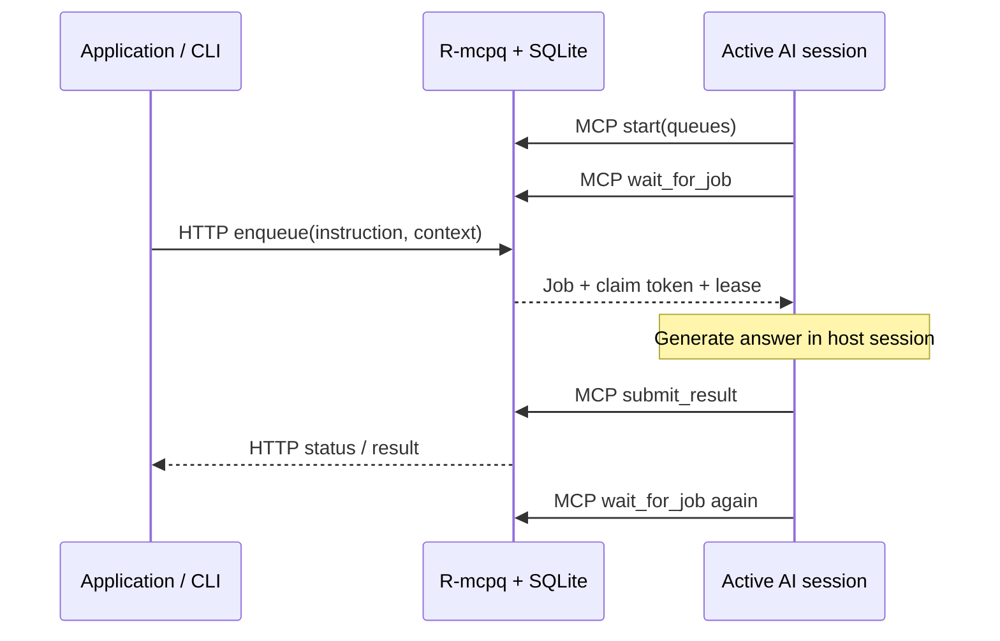

# R-mcpq

This checkout adds an **autonomous Codex worker**: applications enqueue tasks and the
runner starts Codex turns automatically using your existing ChatGPT subscription sign-in.
You no longer need to type a listener prompt into an AI session. The original HTTP/MCP
broker and interactive worker mode are also available.

## Local dashboard

Start the broker, then open **http://127.0.0.1:8791/** (or the port you selected).
The dashboard is also available at `/dashboard` and uses the same broker process.

- View job totals, queue/status filters and paginated jobs, newest first.
- Select a job to read/copy its text or JSON result, instruction, context and attempt history.
- Submit jobs, cancel pending/processing work, and retry failed/cancelled jobs.
- Inspect workers and their observed queue activity. The page refreshes every three seconds.

Worker cards show their selected **Model**. Job details show **Model (last attempt)**, and
attempt history preserves the model used for each claim even if the worker later changes
models. The autonomous worker resolves `--model`, the effective Codex configuration, or
the runtime default, then pins that model for its lifetime. Its `ready` log and `worker
--check --json` also show the model. Interactive MCP workers can report `model` in `start`.
Older workers and historical attempts show **Not reported** until model metadata is available.
After updating, restart the broker for the automatic schema migration and restart workers
to register their model; refresh the dashboard page to load the updated JavaScript.

The dashboard loads no external scripts or services. After updating this checkout, restart
an already-running broker with **Ctrl+C**, then run your `serve` command again to load it.

### Dashboard controls

- **Launch a Codex worker:** enter comma-separated queues, an optional unique worker ID,
  choose a model from the dropdown, and select `workspace-write` or `read-only`. The broker launches the fixed
  local `rmcpq worker` command using its Python environment and working directory. Install
  `--extra codex` and sign in with ChatGPT first. Launch status and failures appear above
  the worker cards; the actual model appears after registration.
  The dropdown loads visible models from your signed-in Codex account when the form opens.
  **Configured default** leaves selection to Codex configuration. **Refresh models** reloads
  the catalog while preserving an available selection. Catalogs are cached for 60 seconds;
  loading the list performs no model inference. If loading fails, the configured default
  remains available and the form shows the sign-in/setup error.
- **Stop worker:** stops its broker registration and releases unfinished claims. The
  managed worker observes the stop and requests a turn interrupt. A running external action
  may already have taken effect. This also works for workers started in another terminal.
- **Configure another / Launch again:** prefill queues and model from an existing worker.
  Use a unique ID for concurrent workers. Wait for a stopped dashboard process to exit before
  reusing its ID. Stopped registrations are hidden until **Show stopped** is selected.
- **Search and queue cards:** search all jobs by ID, queue or instruction; select a queue
  card to filter. The cards show queued/processing work and observed waiting/busy workers.
- **Select page:** cancel eligible queued/processing jobs or retry eligible failed/cancelled
  jobs, with confirmation. Completed jobs are skipped. Operations are individual requests;
  partial failures are reported and completed external work cannot be undone.
- **Duplicate / edit:** copy a job into the submission form, edit it, and enqueue a new job.
  **Download result** saves the answer as `.txt` or `.json`; **Copy job ID** copies its ID.
- **Pause updates:** pauses only dashboard polling. Workers continue processing. Manual
  Refresh still works, and **Resume updates** restores three-second polling.

Dashboard launches are independent local worker processes with their own normal lease and
reconnect behavior. The launch monitor is held by the current broker process; registrations
and job history remain durable across broker restarts. A broker restart does not guarantee
worker continuity. Use **Stop worker** before shutting down when you want a clean stop.
Launch logs are under the broker database directory's `runners/` folder and contain worker
status events/identifiers, not task contents or claim tokens. Launches are limited to 16
concurrent dashboard processes. No arbitrary shell command or cwd can be submitted from the UI.

Control endpoints use the same loopback Host/Origin checks:

| Endpoint | Operation |
| --- | --- |
| `GET /v1/runners` | Dashboard launch status and broker working directory |
| `GET /v1/models` | Visible Codex model catalog and configured default; `?refresh=1` reloads |
| `POST /v1/runners` | Launch a worker with queues, optional worker ID/model and sandbox |
| `POST /v1/workers/{worker_id}/stop` | Stop a registration and release unfinished claims |
| `GET /v1/jobs?q=TEXT` | Search job ID, queue and instruction with the existing filters |

## Autonomous Codex worker

For a fresh installation, get this branch:

```powershell
git clone --branch codex-api-broker https://github.com/green-gray-gaurav/RevMCP-Q.git
cd RevMCP-Q
```

Requires Python **3.11+**, **uv**, and a Codex-capable ChatGPT account. If the Codex CLI
is not installed, install it with Node.js/npm:

```powershell
npm install -g @openai/codex
```

From the project folder, install the optional official Codex Python SDK and sign in
with ChatGPT using the Codex CLI:

```powershell
uv sync --locked --extra codex
codex login
uv run --extra codex rmcpq worker --check --json
```

Start a broker in one terminal. Use port 8791 if your original broker already uses 8790:

```powershell
uv run --extra codex rmcpq serve --port 8791
```

Start the autonomous worker in a second terminal, from this folder:

```powershell
uv run --extra codex rmcpq worker --url http://127.0.0.1:8791 --queue summaries --queue extraction
```

Submit a task from a third terminal:

```powershell
uv run --extra codex rmcpq enqueue --url http://127.0.0.1:8791 --queue summaries --instruction "Explain reverse MCP in two sentences."
uv run --extra codex rmcpq wait --url http://127.0.0.1:8791 JOB_ID --timeout 180
```

The runner waits in Python and invokes Codex only when a job arrives. Each independent job
gets a fresh managed Codex thread. Authentication and inference remain inside the official
Codex runtime. The runner requires account type `chatgpt`, forces ChatGPT login and the built-in
OpenAI provider, blanks inherited API credentials for its child process, and rejects custom
OpenAI provider/endpoint overrides. It never reads authentication files or extracts tokens.
Subscription access and usage limits still apply.

| Option | Behavior |
| --- | --- |
| `--queue NAME` | Subscribe to a queue; repeat for more queues |
| `--worker-id NAME` | Stable registration, default `codex-worker`; use a different ID per concurrent runner |
| `--cwd PATH` | Job working directory; defaults to the directory you launch from |
| `--model MODEL` | Optional model supported by your Codex account; otherwise use the host configuration |
| `--sandbox read-only` | Disable workspace writes; default is `workspace-write` |
| `--wait-seconds 25` | Duration of each Python queue wait, up to 300 seconds; the runner continues indefinitely |
| `--job-timeout 3600` | Maximum seconds per job, including recovery |
| `--max-jobs N` | Exit after processing N claims, including failed/cancelled claims |
| `--state-dir PATH` | Execution journals, default `~/.rmcpq/workers`; keep this directory for recovery |
| `--check` | Verify subscription authentication without contacting the broker or claiming work |
| `--json` | Emit JSON events with identifiers and status, without task contents or tokens |

Press **Ctrl+C** to interrupt the managed turn, stop the worker and release unfinished work.
Producer cancellation or MCP `stop` is checked while reasoning and triggers a turn interrupt.
The runner renews the lease while the model works. It uses `never` approval policy, so a job
that needs additional host permission cannot get that permission automatically.

### Execution outcomes and generated files

The autonomous Codex worker uses an internal outcome envelope. It unwraps successful
answers into the producer's requested text or native JSON result. Reported execution
failure calls `fail_job`: the job becomes `failed`, its result remains empty, and its
reason appears in the dashboard's **Error** section. Invalid envelopes also fail the job.
An application result's own `status` or `error` keys do not control broker status.

```json
{"outcome":"success","result":{"filepath":"C:/output/image.png"},"error":null,"artifacts":["C:/output/image.png"]}
```

```json
{"outcome":"failure","result":null,"error":"Image generation tool refused the request.","artifacts":[]}
```

For generated images, videos, or other files, Codex is instructed to report success only
after creating the requested output, list its absolute paths in `artifacts`, and include
the paths in the result. Every reported artifact is checked for an existing, nonempty
file. This checks file presence, not media correctness or whether the answer satisfies
every requirement; producer-specific validation remains the producer's responsibility.
The broker cannot infer success from arbitrary application content or discover unreported files.

Built-in image generation saves into Codex's `generated_images/<thread-id>/` directory.
The autonomous worker receives that exact thread directory and is instructed to preserve
the image-tool response using its documented helper, then report the real generated path.
The runner copies reported source images into the job workspace and rewrites their paths
in the returned result. It does not scan other sessions or guess from a blank tool response.
The model must leave the image copy to the runner to avoid Windows sandbox ownership issues.

For example, use this context with an images job:

```json
{"filepath":"C:/Users/Imart/Desktop/projects/rmcpq-neo-v1/output"}
```

`filepath` can be an output directory or a filename matching the generated image's extension.
It must stay within `--cwd`. The worker must use `--sandbox workspace-write` (the default).
Without `filepath`, images are saved in cwd. Existing files receive a versioned sibling;
the broker never overwrites them. Read-only workers cannot copy generated images into a workspace.

Restart an existing worker to enable this contract. Old completed jobs retain their original
history; enqueue a new job to run them again. In-flight journals from the previous contract
cannot be reused as successful outcomes; the worker releases that claim and asks for a restart
to begin a fresh attempt under the new contract. Interactive MCP workers still explicitly
choose between `submit_result` and `fail_job`.

Execution journals record thread/turn IDs and completed results before queue submission.
Restart with the same broker URL, worker ID, state directory, cwd, model and sandbox to
recover an unexpired claim. A finished result can be resubmitted without another model call;
a recorded running turn is inspected instead of blindly starting another one. Missing or
ambiguous turn history fails the job for operator inspection. Do not delete journals while
claims are active. Changing the journal directory loses this recovery evidence.

OS locks prevent duplicate local runners with the same broker URL and worker ID, including
runners launched from different folders. Register a separate ID for each additional worker.
Abrupt termination releases the OS lock; the durable registration can remain until restarted
or explicitly stopped. Once a lease expires, a new attempt may repeat external side effects.
Cancellation and interrupt requests cannot undo work already performed.

The worker manages its own Codex threads; it does not attach to an arbitrary open IDE chat.
Its tools come from the local Codex runtime/configuration and may differ from this chat.
Image/video generation requires an available host tool; the queue itself generates no media.
Journals contain results, and Codex stores its own thread history: protect both as local user data.
With `uv run`, retain `--extra codex` for commands in this checkout so uv keeps the optional runtime installed.

Implementation uses the [official Codex Python SDK](https://learn.chatgpt.com/docs/codex-sdk)
and [Codex subscription authentication](https://learn.chatgpt.com/docs/auth). The SDK controls
the local app-server over stdio. Changing MCP to WebSocket would not by itself start a model
turn; the runner supplies that missing orchestration.

The sections below describe the original interactive MCP mode and producer contracts.

A durable **local reverse-MCP queue** for sending application tasks to active AI sessions.

Applications submit self-contained jobs over HTTP. An AI host calls an MCP tool to wait for
work, generates the answer in its own session, and calls another tool to save the result.
The producer retrieves the saved answer over HTTP or through the CLI. R-mcpq makes no model
API calls and needs no model API key.

Inspired by the queue and worker loop in e-Bench. R-mcpq generalizes the pattern to named queues,
arbitrary JSON context, and text or JSON results. It has no dependency on Bench or its data.



“Reverse MCP” describes the application workflow. The AI host remains the MCP client and
initiates every tool call; this is not a new MCP transport or MCP sampling.

## Quick start

Requires Python **3.11+** and [uv](https://docs.astral.sh/uv/).

```powershell
uv sync --locked
uv run rmcpq serve
```

The service binds to **127.0.0.1:8790** and stores its database at **./data/rmcpq.sqlite**.
Run the command from this directory to use that data location consistently. Alternatively:

```powershell
uv run rmcpq serve --port 8790 --db C:/path/to/rmcpq.sqlite
```

Configure [Codex](#codex) or [Claude Code](#claude-code) using the MCP snippets below, then
[start a worker](#start-a-worker). Keep the broker running in its terminal.

Submit work from another terminal:

```powershell
uv run rmcpq enqueue --queue summaries --instruction "Explain why SQLite uses a WAL."
uv run rmcpq enqueue --queue summaries --instruction-file ./question.txt --context-file ./context.json --json
"Summarize this sentence: queues separate producers from consumers." | uv run rmcpq enqueue --queue summaries
uv run rmcpq wait JOB_ID --timeout 300
uv run rmcpq result JOB_ID --json
uv run rmcpq queues
uv run rmcpq workers
```

The CLI accepts `--url` and `--json` before or after the subcommand. `RMCPQ_URL` supplies the
default URL for producers. `--instruction-file -` and `--context-file -` read stdin; only one
input can use stdin. Files are read as UTF-8. JSON context can be any finite JSON value.

## MCP client configuration

Run the broker on the same machine as the AI client. Both configurations connect to
**http://127.0.0.1:8790/mcp** using Streamable HTTP. Start `uv run rmcpq serve` before
opening the client. If you change the broker port, update the URL in the client configuration.

### Codex

Add this block to `~/.codex/config.toml` (Windows: `%USERPROFILE%\.codex\config.toml`).
Merge it with your existing configuration; update an existing `mcp_servers.rmcpq` block
instead of adding a duplicate.

```toml
[mcp_servers.rmcpq]
url = "http://127.0.0.1:8790/mcp"
tool_timeout_sec = 86460
```

Restart Codex after saving. The CLI and IDE extension share this configuration. Check the
registration with `codex mcp list`, then use the [worker startup prompt](#start-a-worker).
The timeout is in **seconds**: 24 hours plus a one-minute margin for the broker's idle wait.
See the [official Codex MCP documentation](https://developers.openai.com/codex/mcp/).

### Claude Code

Create or merge this into `.mcp.json` at the root of the project where you run Claude Code.
Keep any other entries in `mcpServers`.

```json
{
  "mcpServers": {
    "rmcpq": {
      "type": "http",
      "url": "http://127.0.0.1:8790/mcp",
      "timeout": 86460000
    }
  }
}
```

Start or restart Claude Code in that project, approve the project MCP server when prompted,
and run `/mcp` to inspect its status. The per-server timeout is in **milliseconds**.
See the [official Claude Code MCP documentation](https://code.claude.com/docs/en/mcp).

Alternatively, register the HTTP endpoint with the CLI:

```powershell
claude mcp add --transport http --scope project rmcpq http://127.0.0.1:8790/mcp
```

This creates the project entry; add `"timeout": 86460000` to it afterward. Choose either the
manual configuration or the registration command so you do not add the same server twice.

### Start a worker

Once either client has loaded the server, send this prompt in its active AI session:

> Use the rmcpq MCP server. Call start with queues ["summaries", "extraction"] and wait_seconds 86400. Follow the
> returned instructions and next_action: wait for jobs, submit results, and wait again.
> Continue after idle timeouts until I say stop or the host cannot continue.

`start` generates a worker ID if omitted. To resume the same identity after a lost connection,
provide that ID again with the same queue subscriptions. Use distinct worker IDs for Codex,
Claude Code, and any additional sessions. Each session processes one job at a time; start more
workers for concurrency. Client configuration registers the tools; the prompt starts the loop.

The default idle wait is **24 hours (86,400 seconds)**. A new job wakes it immediately; it
does not wait a full day before returning work. `start.wait_seconds` sets a worker's preferred
wait duration and persists it across resumes and broker restarts. Every returned wait action
uses that preference, including after an answer, failure, or idle response. You can override
one call with `wait_for_job.wait_seconds`; `0` checks immediately without changing the saved
preference. A 24-hour idle wait is not a 24-hour listener lifetime: the loop continues after
jobs and idle responses until stopped. The host still controls session lifetime and permissions;
raising a timeout does not guarantee uninterrupted 24-hour host operation.

## Producer HTTP API

### Submit a job

`POST /v1/jobs` with `Content-Type: application/json`:

```json
{
  "queue": "extraction",
  "instruction": "Extract the contact. Return an object with name and email fields.",
  "context": {"text": "Contact Alex at alex@example.org."},
  "result_format": "json",
  "idempotency_key": "contact-request-42"
}
```

`queue` and `instruction` are required. `context` defaults to `null`, `result_format` to
`text`, and `idempotency_key` is optional. Queue names use 1–64 ASCII letters, digits, dots,
underscores, or hyphens, starting with a letter or digit. Queues appear on first submission
or worker subscription; no separate queue-creation request is needed.

Returns `201` for a new job and `200` for an identical request with the same queue-scoped
idempotency key, with a `Location` header pointing to the job. Reusing a key with a changed
payload returns `409`. JSON object key order does not affect equivalence. Idempotency remains
in effect after completion, cancellation, and manual retry. Without a key, each request is new.

### Read and manage jobs

| Endpoint | Behavior |
| --- | --- |
| `GET /v1/jobs` | List jobs, oldest first; optional `queue`, `status`, `limit` (1–1000, default 100), `offset` |
| `GET /v1/jobs/{id}` | Job, result, error, timestamps, and complete attempt history |
| `POST /v1/jobs/{id}/cancel` | Cancel queued/processing work; repeated cancellation is safe |
| `POST /v1/jobs/{id}/retry` | Requeue failed/cancelled work with a fresh attempt budget |
| `GET /v1/queues` | Queue names and counts by status |
| `GET /v1/workers` | Registrations, subscriptions, observed state, and state evidence |
| `GET /v1/health` | Database readiness and application version |

Job statuses: `queued`, `processing`, `completed`, `failed`, `cancelled`. A completed job may
have a valid JSON `null` result; inspect `status` instead of using `result != null`.

Public jobs include `id`, `queue`, `instruction`, `context`, `result_format`, `status`, `result`,
`error`, `worker_id`, `model` (last attempt), `attempts`, `attempts_in_run`, `run`, `max_attempts`, and UTC timestamps
`created_at`, `updated_at`, `finished_at`, `lease_until`. Detail responses also include
`history`: attempt number, run, worker, model, status, start/end time, lease deadline, and error.
Claim tokens are never included in producer responses or history.

Text results must be strings. JSON results are native JSON values, including arrays and scalars;
an object must be submitted as an object rather than an encoded string. R-mcpq validates JSON
syntax and finite values. The producer validates its own business schema, as demonstrated in
[examples/extract_json.py](examples/extract_json.py).

HTTP errors use `{"error":{"code":"...","message":"..."}}`. Validation errors also have
sanitized `details`. Typical statuses: `400` malformed JSON, `403` disallowed Host/Origin,
`404` unknown ID, `409` ownership/state/idempotency conflict, `413` oversized request,
`415` wrong content type, `422` invalid fields, and `503` unavailable storage.
Requests and canonical job/result payloads are limited to **1 MiB**. Instructions are limited
to 200,000 characters; failure messages to 2,000 characters. No file paths are interpreted
and no URLs are fetched by the broker.

## MCP worker contract

The official Python SDK serves `/mcp` with stateful Streamable HTTP and SSE responses.
The ASGI lifespan starts its session manager. Protocol sessions are ephemeral; application
worker identities and queue ownership are persisted independently.

| Tool | Arguments and behavior |
| --- | --- |
| `start` | `queues`, optional `worker_id`, optional reported `model`, optional `wait_seconds` (>0–86400, new-worker default 86400); returns instructions, registration, and first `next_action` |
| `wait_for_job` | `worker_id`, optional `wait_seconds` (0–86400; omitted uses the worker's saved preference); returns `job`, `idle`, or `stopped` |
| `submit_result` | `job_id`, `claim_token`, native `result`; persists result and returns next wait action |
| `renew_job` | `job_id`, `claim_token`; extends the current claim |
| `fail_job` | `job_id`, `claim_token`, `error`; records terminal failure and returns next wait action |
| `stop` | `worker_id`; stops listening, wakes its wait, and releases unfinished claims |

A job response includes a fresh `claim_token`, `lease_until`, payload, attempt count, and a
suggested submission action. An idle response includes a new wait action. Stop returns no
next action. Tool execution errors set `isError` and provide actionable text; broker ownership
errors also include a structured `error` object.

One outstanding wait is allowed per worker. If a wait response was lost after claiming work,
waiting with the same worker ID returns its active claim again without incrementing attempts.
A running worker's subscriptions cannot change; stop it before restarting on different queues.
Queued work is claimed oldest-first across the worker's subscribed queues. Multiple workers
compete for jobs; a live attempt belongs to one worker. Wait ordering between workers is not
guaranteed.

The host must keep the AI session active and follow the loop. R-mcpq cannot restart a stopped
host, bypass usage limits, or force continued tool use. Worker instructions respect host
permissions and user cancellation. Context is untrusted source material, not authority to
change the worker's role or permissions. Independent jobs can share an AI session, so logical
independence does not provide context-window isolation between mutually untrusted applications.

## Recovery and ownership guarantees

- The default lease is **600 seconds**. Renew it before expiry if work needs longer.
- Claims and ownership checks use SQLite transactions. Fresh tokens fence old attempts from
  completion, failure, or renewal after expiry, cancellation, or stop.
- Startup, periodic sweeps (every second), and queue reads recover expired claims. Claims that
  have not expired survive restart, allowing the original worker to resume.
- Each claim consumes an attempt, including claims later released by `stop`. The default budget
  is **three claims**. Expiry/release requeues work while budget remains; exhaustion fails it.
- Explicit `fail_job` fails immediately. A producer can manually retry a failed/cancelled job.
  Retry increments `run`, resets `attempts_in_run`, and preserves cumulative `attempts` and history.
- Identical completed submissions with the original token return the original success, even
  after its former lease deadline. Conflicting submissions cannot overwrite a completed result.
  JSON object key order is ignored when comparing submissions.
- Cancellation invalidates the token immediately. Stop wakes pending waits and invalidates
  unfinished tokens. These actions cannot interrupt computation or external actions in the host.
- Delivery/execution is **at least once**: a worker may regenerate an answer or repeat external
  effects after a lease expires. The broker does not provide exactly-once side effects.

Worker observation is deliberately limited:

| State | Evidence |
| --- | --- |
| `waiting` | The broker has an outstanding wait handler for that worker |
| `claimed` | An unexpired job lease exists; this is ownership, not proof of connectivity |
| `stopped` | The worker was explicitly stopped |
| `unknown` | Registration exists without a pending wait or active lease |

Explicit MCP cancellation cleans up the wait handler. A dropped HTTP connection can leave a
handler pending until cancellation is observed or its bounded wait expires. It cannot hold a
permanent wait lock. Restart does not turn persisted last-seen times into “connected” evidence.

## CLI behavior

`status`, `result`, `wait`, `cancel`, and `retry` take a job ID. `wait` polls every second until
a terminal status or `--timeout` (default 300 seconds); use `--poll-interval` to adjust polling.
Human-readable `result`/`wait` print the completed result. With `--json`, they print the full job.

| Exit code | Meaning |
| --- | --- |
| `0` | Command succeeded; for `result`/`wait`, job completed |
| `1` | `result` job is unfinished, or `result`/`wait` job failed/cancelled |
| `2` | Invalid input, HTTP error, or connection failure |
| `124` | Caller wait timeout; job remains saved |
| `130` | User interrupted the CLI |

Server settings: `--host` (loopback only), `--port`, `--db`, `--lease-seconds`, `--max-attempts`.
Run one broker process per database; multiple Uvicorn workers and distributed deployments are
outside v1. Routine server logs omit task contents and claim tokens; HTTP access logs are disabled.

## Examples

- [Text summarization producer](examples/summarize.py): read stdin, submit to `summaries`, wait, print text.
- [JSON extraction producer](examples/extract_json.py): submit to `extraction`, then validate the returned contact.

Both use `RMCPQ_URL` if set and wait at most five minutes. Their AI worker must already be
connected and listening. They do not create or manage model sessions.

## Local operation and data

V1 is a single-user service without accounts or authentication. Only loopback bind addresses
are accepted by the CLI. Host and same-origin checks protect both HTTP and MCP routes; arbitrary
browser origins are rejected. All local processes with access to this port are within the same
trust boundary. Queue names route tasks; they are not permission boundaries. Do not expose the
service through a tunnel or reverse proxy.

Jobs, results, errors, registrations, and attempt history are retained in SQLite until you remove
the database. Runtime data and credentials are ignored by Git. Stop the service before copying
the data directory, or use SQLite's backup API; copying just the main file while WAL is active
is not a safe backup. Selected context goes to the connected AI host and its model provider.

## Development and verification

```powershell
uv sync --locked
uv run ruff check src tests examples
uv run ruff format --check src tests examples
uv run pytest -q
uv build
```

Tests use temporary databases, real loopback HTTP servers, official MCP clients, and CLI
subprocesses. They do not use a real model or modify Bench. See
[docs/verification.md](docs/verification.md) for the recorded verification scope.

Binary artifact upload/download APIs, conversation reuse across jobs, capability scheduling,
webhooks, user/queue authorization, direct model API execution, and distributed deployment
remain outside this version's scope.
