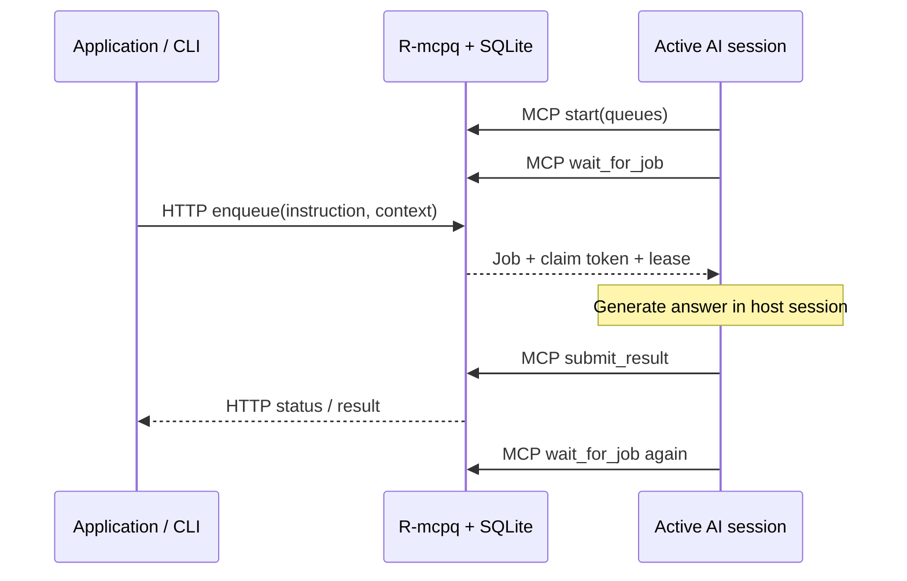

# R-mcpq

A durable **local reverse-MCP queue** for sending application tasks to active AI sessions.

Applications submit self-contained jobs over HTTP. An AI host calls an MCP tool to wait for
work, generates the answer in its own session, and calls another tool to save the result.
The producer retrieves the saved answer over HTTP or through the CLI. R-mcpq makes no model
API calls and needs no model API key.

Inspired by the queue and worker loop in e-Bench. R-mcpq generalizes the pattern to named queues,
arbitrary JSON context, and text or JSON results. It has no dependency on Bench or its data.



“Reverse MCP” describes the application workflow. The AI host remains the MCP client and
initiates every tool call; this is not a new MCP transport or MCP sampling.

## Quick start

Requires Python **3.11+** and [uv](https://docs.astral.sh/uv/).

```powershell
uv sync --locked
uv run rmcpq serve
```

The service binds to **127.0.0.1:8790** and stores its database at **./data/rmcpq.sqlite**.
Run the command from this directory to use that data location consistently. Alternatively:

```powershell
uv run rmcpq serve --port 8790 --db C:/path/to/rmcpq.sqlite
```

Connect an MCP-capable AI host to **http://127.0.0.1:8790/mcp** using Streamable HTTP.
Use a tool timeout above 25 seconds; if you increase `wait_seconds`, increase the host timeout
as well. Give the active session this instruction:

> Start R-mcpq by calling start with queues ["summaries", "extraction"]. Follow the returned
> instructions and next_action: wait for jobs, submit results, and wait again. Continue after
> idle timeouts until I say stop or the host cannot continue.

`start` generates a worker ID if omitted. To resume the same identity after a lost connection,
provide that ID again with the same queue subscriptions. Use distinct worker IDs for distinct
AI sessions. Each host session processes one job at a time; start more workers for concurrency.

Submit work from another terminal:

```powershell
uv run rmcpq enqueue --queue summaries --instruction "Explain why SQLite uses a WAL."
uv run rmcpq enqueue --queue summaries --instruction-file ./question.txt --context-file ./context.json --json
"Summarize this sentence: queues separate producers from consumers." | uv run rmcpq enqueue --queue summaries
uv run rmcpq wait JOB_ID --timeout 300
uv run rmcpq result JOB_ID --json
uv run rmcpq queues
uv run rmcpq workers
```

The CLI accepts `--url` and `--json` before or after the subcommand. `RMCPQ_URL` supplies the
default URL for producers. `--instruction-file -` and `--context-file -` read stdin; only one
input can use stdin. Files are read as UTF-8. JSON context can be any finite JSON value.

## Producer HTTP API

### Submit a job

`POST /v1/jobs` with `Content-Type: application/json`:

```json
{
  "queue": "extraction",
  "instruction": "Extract the contact. Return an object with name and email fields.",
  "context": {"text": "Contact Alex at alex@example.org."},
  "result_format": "json",
  "idempotency_key": "contact-request-42"
}
```

`queue` and `instruction` are required. `context` defaults to `null`, `result_format` to
`text`, and `idempotency_key` is optional. Queue names use 1–64 ASCII letters, digits, dots,
underscores, or hyphens, starting with a letter or digit. Queues appear on first submission
or worker subscription; no separate queue-creation request is needed.

Returns `201` for a new job and `200` for an identical request with the same queue-scoped
idempotency key, with a `Location` header pointing to the job. Reusing a key with a changed
payload returns `409`. JSON object key order does not affect equivalence. Idempotency remains
in effect after completion, cancellation, and manual retry. Without a key, each request is new.

### Read and manage jobs

| Endpoint | Behavior |
| --- | --- |
| `GET /v1/jobs` | List jobs, oldest first; optional `queue`, `status`, `limit` (1–1000, default 100), `offset` |
| `GET /v1/jobs/{id}` | Job, result, error, timestamps, and complete attempt history |
| `POST /v1/jobs/{id}/cancel` | Cancel queued/processing work; repeated cancellation is safe |
| `POST /v1/jobs/{id}/retry` | Requeue failed/cancelled work with a fresh attempt budget |
| `GET /v1/queues` | Queue names and counts by status |
| `GET /v1/workers` | Registrations, subscriptions, observed state, and state evidence |
| `GET /v1/health` | Database readiness and application version |

Job statuses: `queued`, `processing`, `completed`, `failed`, `cancelled`. A completed job may
have a valid JSON `null` result; inspect `status` instead of using `result != null`.

Public jobs include `id`, `queue`, `instruction`, `context`, `result_format`, `status`, `result`,
`error`, `worker_id`, `attempts`, `attempts_in_run`, `run`, `max_attempts`, and UTC timestamps
`created_at`, `updated_at`, `finished_at`, `lease_until`. Detail responses also include
`history`: attempt number, run, worker, status, start/end time, lease deadline, and error.
Claim tokens are never included in producer responses or history.

Text results must be strings. JSON results are native JSON values, including arrays and scalars;
an object must be submitted as an object rather than an encoded string. R-mcpq validates JSON
syntax and finite values. The producer validates its own business schema, as demonstrated in
[examples/extract_json.py](examples/extract_json.py).

HTTP errors use `{"error":{"code":"...","message":"..."}}`. Validation errors also have
sanitized `details`. Typical statuses: `400` malformed JSON, `403` disallowed Host/Origin,
`404` unknown ID, `409` ownership/state/idempotency conflict, `413` oversized request,
`415` wrong content type, `422` invalid fields, and `503` unavailable storage.
Requests and canonical job/result payloads are limited to **1 MiB**. Instructions are limited
to 200,000 characters; failure messages to 2,000 characters. No file paths are interpreted
and no URLs are fetched by the broker.

## MCP worker contract

The official Python SDK serves `/mcp` with stateful Streamable HTTP and SSE responses.
The ASGI lifespan starts its session manager. Protocol sessions are ephemeral; application
worker identities and queue ownership are persisted independently.

| Tool | Arguments and behavior |
| --- | --- |
| `start` | `queues`, optional `worker_id`; returns instructions, registration, and first `next_action` |
| `wait_for_job` | `worker_id`, optional `wait_seconds` (0–300, default 25); returns `job`, `idle`, or `stopped` |
| `submit_result` | `job_id`, `claim_token`, native `result`; persists result and returns next wait action |
| `renew_job` | `job_id`, `claim_token`; extends the current claim |
| `fail_job` | `job_id`, `claim_token`, `error`; records terminal failure and returns next wait action |
| `stop` | `worker_id`; stops listening, wakes its wait, and releases unfinished claims |

A job response includes a fresh `claim_token`, `lease_until`, payload, attempt count, and a
suggested submission action. An idle response includes a new wait action. Stop returns no
next action. Tool execution errors set `isError` and provide actionable text; broker ownership
errors also include a structured `error` object.

One outstanding wait is allowed per worker. If a wait response was lost after claiming work,
waiting with the same worker ID returns its active claim again without incrementing attempts.
A running worker's subscriptions cannot change; stop it before restarting on different queues.
Queued work is claimed oldest-first across the worker's subscribed queues. Multiple workers
compete for jobs; a live attempt belongs to one worker. Wait ordering between workers is not
guaranteed.

The host must keep the AI session active and follow the loop. R-mcpq cannot restart a stopped
host, bypass usage limits, or force continued tool use. Worker instructions respect host
permissions and user cancellation. Context is untrusted source material, not authority to
change the worker's role or permissions. Independent jobs can share an AI session, so logical
independence does not provide context-window isolation between mutually untrusted applications.

## Recovery and ownership guarantees

- The default lease is **600 seconds**. Renew it before expiry if work needs longer.
- Claims and ownership checks use SQLite transactions. Fresh tokens fence old attempts from
  completion, failure, or renewal after expiry, cancellation, or stop.
- Startup, periodic sweeps (every second), and queue reads recover expired claims. Claims that
  have not expired survive restart, allowing the original worker to resume.
- Each claim consumes an attempt, including claims later released by `stop`. The default budget
  is **three claims**. Expiry/release requeues work while budget remains; exhaustion fails it.
- Explicit `fail_job` fails immediately. A producer can manually retry a failed/cancelled job.
  Retry increments `run`, resets `attempts_in_run`, and preserves cumulative `attempts` and history.
- Identical completed submissions with the original token return the original success, even
  after its former lease deadline. Conflicting submissions cannot overwrite a completed result.
  JSON object key order is ignored when comparing submissions.
- Cancellation invalidates the token immediately. Stop wakes pending waits and invalidates
  unfinished tokens. These actions cannot interrupt computation or external actions in the host.
- Delivery/execution is **at least once**: a worker may regenerate an answer or repeat external
  effects after a lease expires. The broker does not provide exactly-once side effects.

Worker observation is deliberately limited:

| State | Evidence |
| --- | --- |
| `waiting` | The broker has an outstanding wait handler for that worker |
| `claimed` | An unexpired job lease exists; this is ownership, not proof of connectivity |
| `stopped` | The worker was explicitly stopped |
| `unknown` | Registration exists without a pending wait or active lease |

Explicit MCP cancellation cleans up the wait handler. A dropped HTTP connection can leave a
handler pending until cancellation is observed or its bounded wait expires. It cannot hold a
permanent wait lock. Restart does not turn persisted last-seen times into “connected” evidence.

## CLI behavior

`status`, `result`, `wait`, `cancel`, and `retry` take a job ID. `wait` polls every second until
a terminal status or `--timeout` (default 300 seconds); use `--poll-interval` to adjust polling.
Human-readable `result`/`wait` print the completed result. With `--json`, they print the full job.

| Exit code | Meaning |
| --- | --- |
| `0` | Command succeeded; for `result`/`wait`, job completed |
| `1` | `result` job is unfinished, or `result`/`wait` job failed/cancelled |
| `2` | Invalid input, HTTP error, or connection failure |
| `124` | Caller wait timeout; job remains saved |
| `130` | User interrupted the CLI |

Server settings: `--host` (loopback only), `--port`, `--db`, `--lease-seconds`, `--max-attempts`.
Run one broker process per database; multiple Uvicorn workers and distributed deployments are
outside v1. Routine server logs omit task contents and claim tokens; HTTP access logs are disabled.

## Examples

- [Text summarization producer](examples/summarize.py): read stdin, submit to `summaries`, wait, print text.
- [JSON extraction producer](examples/extract_json.py): submit to `extraction`, then validate the returned contact.

Both use `RMCPQ_URL` if set and wait at most five minutes. Their AI worker must already be
connected and listening. They do not create or manage model sessions.

## Local operation and data

V1 is a single-user service without accounts or authentication. Only loopback bind addresses
are accepted by the CLI. Host and same-origin checks protect both HTTP and MCP routes; arbitrary
browser origins are rejected. All local processes with access to this port are within the same
trust boundary. Queue names route tasks; they are not permission boundaries. Do not expose the
service through a tunnel or reverse proxy.

Jobs, results, errors, registrations, and attempt history are retained in SQLite until you remove
the database. Runtime data and credentials are ignored by Git. Stop the service before copying
the data directory, or use SQLite's backup API; copying just the main file while WAL is active
is not a safe backup. Selected context goes to the connected AI host and its model provider.

## Development and verification

```powershell
uv sync --locked
uv run ruff check src tests examples
uv run ruff format --check src tests examples
uv run pytest -q
uv build
```

Tests use temporary databases, real loopback HTTP servers, official MCP clients, and CLI
subprocesses. They do not use a real model or modify Bench. See
[docs/verification.md](docs/verification.md) for the recorded verification scope.

V1 excludes binary artifacts, dashboards, persistent conversations, capability scheduling,
webhooks, user/queue authorization, model API execution, and distributed deployment.
